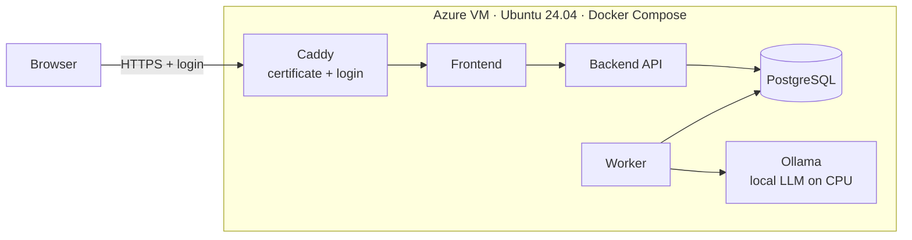

# Deploying on Microsoft Azure

One script, run from Azure Cloud Shell, puts the whole application on an Azure virtual machine
with HTTPS, a login, nightly database backups and an automatic nightly shutdown:

```bash
ACME_EMAIL=you@example.org ./deploy/azure/azure.sh up
```

The result is a site such as `https://mpai-1a2b3c4d.centralindia.cloudapp.azure.com` that asks
for a username and password before showing anything.



Everything in [the README's production setup](README.md#production-with-https-any-server) runs
unchanged; the script only automates creating the server and filling in the settings.

## What it costs

The VM is billed per hour while it runs. A stopped (deallocated) VM costs nothing for compute;
its disk and IP address keep costing a small amount each month.

| VM size | vCPU / memory | Model it can run | Price while running (Central India) | Running 24/7 | Running 4 h a day |
|---|---|---|---|---|---|
| `Standard_B4as_v2` (default) | 4 / 16 GB | `llama3.1` (8B) | about $0.098 per hour | about $72 a month | about $12 a month |
| `Standard_B4als_v2` | 4 / 8 GB | `qwen2.5:3b` | about $0.087 per hour | about $64 a month | about $10 a month |

Pay-as-you-go Linux prices from [azurespeed.com](https://www.azurespeed.com/AzureVmPricing/Standard_B4as_v2),
checked in October 2026; other regions cost more (South India is roughly double). Check the
[Azure pricing calculator](https://azure.microsoft.com/pricing/calculator/) before you start.

To keep the bill down, the script switches the VM off **every night at 00:00 India time**, and you
can switch it off any time with `./deploy/azure/azure.sh stop`.

### Azure for Students

An Azure for Students subscription works, with limits that differ from account to account:

* It comes with US$100 of credit ([Microsoft Q&A](https://learn.microsoft.com/en-us/answers/questions/2183197/azure-openai-with-azure-for-students)).
* Only a few regions are allowed per account, and some VM sizes are blocked; the B-series v2 sizes
  above are the ones usually available ([Microsoft Tech Community](https://techcommunity.microsoft.com/discussions/microsoft-learn-for-educators/sku-quota-and-policy-restrictions-on-azure-for-students-and-free-subscriptions/4525160/replies/4525557)).
* GPU VMs are generally not available, so the model runs on the CPU. **A paper takes roughly
  30–90 minutes to extract** with the 8B model; plan demos around that.

`./deploy/azure/azure.sh check` shows exactly what your account allows before anything is created.

## Before you start

* An Azure subscription (Azure for Students is fine).
* The project, either in a GitHub repository or as a zip file.
* An e-mail address. It is given to the certificate authorities and used for polite metadata
  lookups.

Nothing needs installing on your laptop: the script runs in Azure Cloud Shell in the browser.

## Step by step

### 1. Open Azure Cloud Shell

Go to [shell.azure.com](https://shell.azure.com) and choose **Bash**. The first time, Azure asks
about storage: choose to **mount a storage account** (Azure creates a small one). That keeps your
home folder, which holds the SSH key the script creates and the saved login. With an ephemeral
session these are lost when the session ends (see Troubleshooting for how to recover).

### 2. Put the project in Cloud Shell

From GitHub:

```bash
git clone https://github.com/<your-user>/microplastic-degradation-ai.git
cd microplastic-degradation-ai
```

For a private repository, Git asks for your GitHub username and a personal access token as the
password.

Or from a zip of the project folder: in the Cloud Shell toolbar choose **Manage files → Upload**,
pick the zip, then:

```bash
unzip microplastic-degradation-ai.zip
cd microplastic-degradation-ai
```

Check that `ls` shows `docker-compose.yml`; if it doesn't, `cd` into the folder that holds it.
Then make the scripts executable:

```bash
chmod +x deploy/azure/*.sh
```

### 3. Check what your subscription allows

```bash
./deploy/azure/azure.sh check
```

Look for three things:

1. **Regions.** Is `centralindia` in the allowed list? If not, pick one that is and add
   `LOCATION=<region>` in front of the commands below (for example `LOCATION=southeastasia`).
2. **Sizes.** `Standard_B4as_v2` should show no restriction. If it is restricted, use
   `VM_SIZE=Standard_B4als_v2 OLLAMA_MODEL=qwen2.5:3b`.
3. **Quota.** "Total Regional vCPUs" must leave at least 4 free.

### 4. Deploy

```bash
ACME_EMAIL=you@example.org ./deploy/azure/azure.sh up
```

With a different region or size, put the settings in front:

```bash
ACME_EMAIL=you@example.org LOCATION=southeastasia ./deploy/azure/azure.sh up
```

To avoid retyping them, copy `deploy/azure/azure.env.example` to `deploy/azure/azure.env` and
edit it (`code deploy/azure/azure.env` opens Cloud Shell's editor).

What happens, and how long it takes the first time:

| Step | Time |
|---|---|
| Create the resource group, VM, IP address with DNS name, firewall rules (22, 80, 443) and the nightly shutdown | 2–4 min |
| First boot: install Docker and a 4 GB swap file | 2–3 min |
| Copy the project; write `.env` with a random database password; create the login | under 1 min |
| Build the images on the VM | 5–10 min |
| Download the model (`llama3.1` is about 5 GB) | 3–10 min |
| Get the HTTPS certificate | 1–5 min |

The build and download run on the VM in the background. Cloud Shell closes after a while without
input, but that does not stop the deployment; open Cloud Shell again and run
`./deploy/azure/azure.sh status`.

At the end the script prints:

```
  Website   https://mpai-1a2b3c4d.centralindia.cloudapp.azure.com
  Username  researcher
  Password  <generated>
```

The password is also saved in `deploy/azure/.credentials` in Cloud Shell. Keep it private.

### 5. Open the site

Open the address, enter the username and password in the browser's login box, and upload a PDF.
The first extraction also loads the model into memory, which adds about a minute.

## Day-to-day commands

Run these from the project folder in Cloud Shell.

| Command | What it does |
|---|---|
| `./deploy/azure/azure.sh status` | Power state, address, health, containers |
| `./deploy/azure/azure.sh stop` | Switch the VM off (deallocate); compute billing stops |
| `./deploy/azure/azure.sh start` | Switch it on; the app starts by itself |
| `./deploy/azure/azure.sh logs worker` | Follow a service's log (`backend`, `worker`, `caddy`, `ollama`, …); Ctrl+C to leave |
| `./deploy/azure/azure.sh config OLLAMA_MODEL=qwen2.5:3b` | Change settings and restart |
| `./deploy/azure/azure.sh password` | New random password (or `password <your-own>`, at least 10 characters) |
| `./deploy/azure/azure.sh backup` | Download a database dump to `deploy/azure/backups/` |
| `./deploy/azure/azure.sh ssh` | Shell on the VM; the app is in `~/app` |
| `./deploy/azure/azure.sh up` | After code changes: copy the new code and rebuild |
| `./deploy/azure/azure.sh destroy` | Delete everything (asks you to type the resource group name) |

**Updating the code.** Get the new version into Cloud Shell (`git pull`, or upload and unzip again)
and run `./deploy/azure/azure.sh up`. The database, uploaded papers, settings and login are kept.

**Nightly shutdown.** The VM switches off at 18:30 UTC (00:00 India time). Change it with
`AUTO_SHUTDOWN_UTC=1630` (UTC, HHMM) on the next `up`, or turn it off with `AUTO_SHUTDOWN_UTC=off`.

**Backups.** On the VM, the database is also dumped into `~/app/backups` each time the VM starts
and every 24 hours while it runs; dumps are kept for 14 days. They live on the VM's disk, so
download one with `backup` before deleting anything.

## Settings worth knowing

Change any of these with `./deploy/azure/azure.sh config KEY=VALUE` (several at once are fine).

| Setting | Azure default | Meaning |
|---|---|---|
| `OLLAMA_MODEL` | `llama3.1` | Model used for extraction; downloaded automatically when changed |
| `MAX_CHUNKS` | `12` | Most text chunks sent per paper; lower is faster but may miss values |
| `VALIDATION_LLM_ENABLED` | `true` | Second AI review per experiment; `false` saves time |
| `EXTRACTION_TIMEOUT_SECONDS` | `14400` | Time limit per paper (4 hours) |
| `OLLAMA_TIMEOUT` | `1800` | Time limit for one model call (30 minutes) |
| `CONTACT_EMAIL` | your `ACME_EMAIL` | Used for Crossref and Unpaywall lookups |

The database settings (`POSTGRES_*`) are fixed after the first deployment.

## HTTPS certificate

The free `*.cloudapp.azure.com` address is shared by every Azure customer, and Let's Encrypt
limits how many certificates it issues for it each week
([Let's Encrypt community](https://community.letsencrypt.org/t/hitting-rate-limit-for-swedencentral-cloudapp-azure-com/217855?page=2)).
Because an e-mail is configured, Caddy falls back to the ZeroSSL certificate authority when Let's
Encrypt refuses, and keeps retrying both.

If the site still has no certificate after 15 minutes, use a domain you own:

1. At your domain registrar, add an **A record** for, say, `extractor.yourname.me`, pointing at
   the VM's IP address (shown by `./deploy/azure/azure.sh status`).
2. Run `ACME_EMAIL=you@example.org CUSTOM_DOMAIN=extractor.yourname.me ./deploy/azure/azure.sh up`.

## Before a demo or panel

* Extract the papers you want to show **the day before**; on the CPU each takes a long time.
* Run `./deploy/azure/azure.sh start` about 15 minutes before, open the site and log in.
* Starting one extraction live is still a good demo: the six-step progress list updates while you
  talk, and you can then switch to a paper that is already extracted.
* For your resume, link the GitHub repository. The live site is switched off most of the time and
  needs a password, so offer it on request or show it during the interview.

## Troubleshooting

| Problem | Fix |
|---|---|
| "disallowed by Azure" or "RequestDisallowedByPolicy" | The region is not allowed for your subscription. Run `check` and use an allowed `LOCATION`. |
| "SkuNotAvailable" | That VM size is blocked. Use `VM_SIZE=Standard_B4als_v2 OLLAMA_MODEL=qwen2.5:3b`. |
| "quota" in the error | Not enough vCPUs left in the region. Delete unused VMs, choose another region, or request more under **Subscriptions → Usage + quotas**. |
| SSH fails after reopening Cloud Shell | The SSH key was lost (ephemeral session). Create one with `ssh-keygen -t rsa -f ~/.ssh/id_rsa -N ""`, then install it: `az vm user update -g mpai-rg -n mpai-vm -u azureuser --ssh-key-value ~/.ssh/id_rsa.pub`. |
| The password is lost | `./deploy/azure/azure.sh password` sets a new one. |
| The browser keeps asking for the login | Wrong username or password; check `deploy/azure/.credentials`. |
| Extraction fails with "model is not installed" | `./deploy/azure/azure.sh logs ollama-pull`; usually a typo in `OLLAMA_MODEL` or a full disk. |
| Extraction fails with "timed out" | Use a smaller model, lower `MAX_CHUNKS`, or raise `EXTRACTION_TIMEOUT_SECONDS`. |
| Services restart during extraction | Out of memory: use a smaller model or the 16 GB size. |
| Extraction is slower than expected | B-series sizes are burstable: they run at full speed until their CPU credits run out, then slow to a baseline ([Azure docs](https://docs.azure.cn/en-us/virtual-machines/sizes/general-purpose/basv2-series)). Long CPU-bound extractions hit that limit. |
| No HTTPS after 15 minutes | See [HTTPS certificate](#https-certificate); `./deploy/azure/azure.sh logs caddy` shows why. |
| `$'\r': command not found` | The scripts were saved with Windows line endings. Fix them with `sed -i 's/\r$//' deploy/azure/*.sh deploy/azure/cloud-init.yaml` and run again. |

## What gets created

In Azure, all inside one resource group (`mpai-rg`), so `destroy` removes everything:

* a VM running Ubuntu 24.04 LTS with a 64 GB Standard SSD disk;
* a static public IP address with the DNS name `<label>.<region>.cloudapp.azure.com`;
* a network security group allowing SSH (22), HTTP (80) and HTTPS (443);
* a daily auto-shutdown schedule.

On the VM:

* Docker Engine with the Compose plugin, a 4 GB swap file;
* the project in `~/app`, started with `docker-compose.yml` + `docker-compose.prod.yml`;
* `~/app/.env` (readable only by the admin user) with a random database password and the
  CPU-friendly settings above;
* `~/app/deploy/auth/basic_auth.caddy`: the login, stored as a bcrypt hash, never the password.

Only Caddy publishes ports. PostgreSQL, Ollama, the API and the frontend are reachable only inside
Docker's private network.

## Files

| File | Role |
|---|---|
| `deploy/azure/azure.sh` | The command-line tool described above |
| `deploy/azure/azure.env.example` | Settings template (copy to `azure.env`) |
| `deploy/azure/cloud-init.yaml` | First-boot setup of the VM (Docker, swap) |
| `deploy/azure/remote-up.sh` | Runs on the VM: build, start, wait for health |
| `deploy/Caddyfile`, `docker-compose.prod.yml` | HTTPS, login, resource limits, backups |
